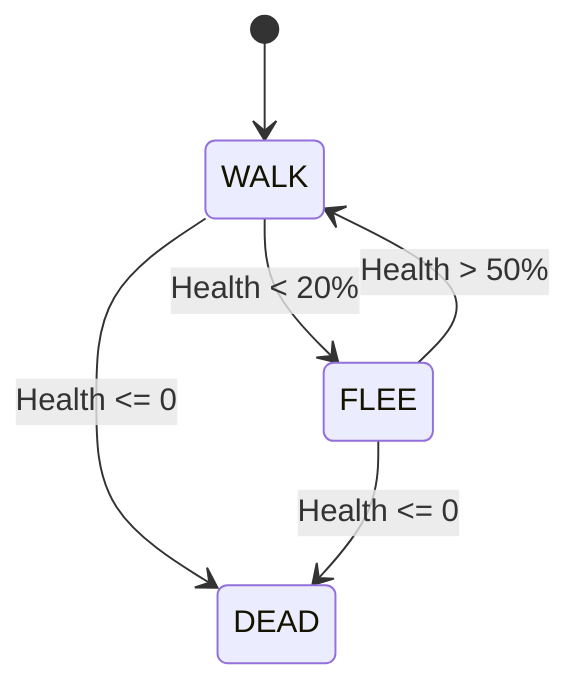

# Tower Defense FSM Game

A browser-based Tower Defense game featuring intelligent enemies controlled by a Finite State Machine (FSM).

## Features
- **FSM AI**: Enemies utilize a State Machine with states: WALK, FLEE, DEAD.
- **Canvas Rendering**: High-performance game loop using HTML5 Canvas.
- **Event System**: Handles 10+ distinct browser events.
- **Game Progression**: Infinite waves with increasing difficulty.

## How to Play
1. **Start**: Click "Play Game" on the main menu.
2. **Defend**: Click anywhere on the map to place a Tower (Cost: 50 Gold).
3. **Survive**: Don't let enemies reach the end of the path!
4. **Pause**: Press 'ESC' to pause the game (to be implemented).

## Technologies Used
- HTML5
- CSS3
- JavaScript (ES6+ Classes)

## FSM Documentation

### State Diagram

### Transition Table
| Current State | Condition | Next State | Action |
|_|_|_|_|
| WALK | Health < 20% | FLEE | Move backwards, speed up |
| FLEE | Health > 50% | WALK | Resume path following |
| ANY | Health <= 0 | DEAD | Play death animation, grant gold |

## Implemented Events
1. `load`: Initialize Game
2. `resize`: Responsive Canvas
3. `keydown`: Input Tracking
4. `keyup`: Input Tracking
5. `mousemove`: Mouse Position
6. `mousedown`: Interaction
7. `mouseup`: Interaction
8. `click`: UI Buttons
9. `contextmenu`: Prevent default
10. `requestAnimationFrame`: Game Loop
