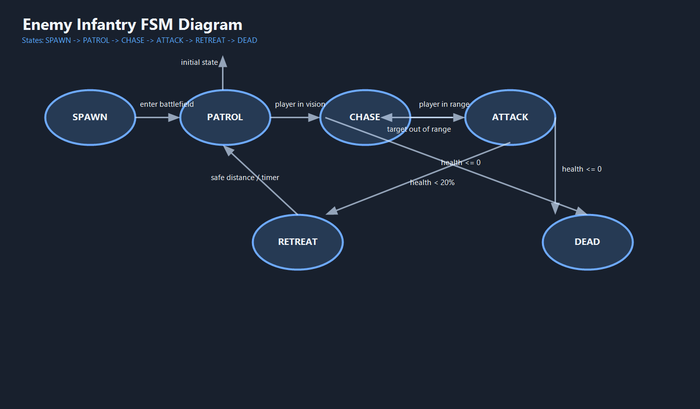

# War Simulator

`War Simulator` is a browser-based HTML5 Canvas combat game built with JavaScript, CSS, and a reusable Finite State Machine system. The project supports land battles and ocean battles, deployable player units, custom maps, pause/settings screens, sound effects, and FSM-driven enemy infantry AI.

## Project Overview

This game was adapted to satisfy the course requirements for:

- HTML5 Canvas rendering
- JavaScript event handling
- reusable FSM-based enemy AI
- documentation of states, transitions, and implemented events

The main intelligent bot in the project is the enemy infantry unit, which now uses a reusable FSM with six states:

- `SPAWN`
- `PATROL`
- `CHASE`
- `ATTACK`
- `RETREAT`
- `DEAD`

## Screenshot / Media

- Start screen logo: [assets/images/Untitled.png](./assets/images/Untitled.png)
- FSM diagram: [fsm-diagram.png](./fsm-diagram.png)
- GitHub Pages link: `Add your deployed URL here before submission`

## How To Play

1. Open [index.html](./index.html) in a browser.
2. Click `Play Game` or open `Make a custom map.` first.
3. Select a unit from the deploy bar.
4. Click or tap the battlefield to place the selected unit.
5. For planes, right-click an airport while `Plane` is selected.
6. Press `ESC` to pause.
7. Press `M` or use the settings screen to mute/unmute audio.

## Core Gameplay

### Land battle mode

On land maps, the player deploys units such as:

- towers
- soldiers
- tanks
- bunkers
- artillery
- snipers
- drones
- airports and planes
- support structures

Enemy forces include:

- infantry
- snipers
- artillery
- tanks
- planes

### Ocean battle mode

On ocean maps, the battle uses naval units:

- player submarines
- player aircraft carriers
- enemy submarines
- enemy aircraft carriers

Each aircraft carrier has `3` planes that lift off from the deck, attack enemy targets, and return.

## Implemented JavaScript Events

This project now uses more than the required minimum of 10 event types.

### Keyboard events

- `keydown`
- `keyup`
- `keypress`

### Mouse events

- `click`
- `mousemove`
- `mousedown`
- `mouseup`
- `contextmenu`
- `wheel`

### Window / document events

- `load`
- `resize`
- `focus`
- `blur`
- `visibilitychange`

### Custom / game events

- `gameStart`
- `gameOver`
- `levelUp`
- `requestAnimationFrame`
- `setTimeout`

### Touch events

- `touchstart`
- `touchmove`
- `touchend`

## FSM Diagram



The reusable FSM base is implemented in [js/fsm.js](./js/fsm.js), and the enemy infantry FSM implementation is in [js/enemy.js](./js/enemy.js).

## FSM Transition Table

| Current State | Input / Condition | Next State | Action |
|---|---|---|---|
| `SPAWN` | enemy enters battlefield area | `PATROL` | start battlefield movement |
| `PATROL` | player target inside vision range | `CHASE` | lock target |
| `PATROL` | health <= 20% | `RETREAT` | disengage |
| `CHASE` | target inside attack range | `ATTACK` | stop advancing and fire |
| `CHASE` | target lost / too far away | `PATROL` | resume movement |
| `CHASE` | health <= 20% | `RETREAT` | break engagement |
| `ATTACK` | target moves out of range | `CHASE` | close distance |
| `ATTACK` | target missing | `PATROL` | search new route |
| `ATTACK` | health <= 20% | `RETREAT` | run back |
| `RETREAT` | timer finished or target far enough | `PATROL` | resume normal behavior |
| `ANY` | health <= 0 | `DEAD` | mark for deletion / play death sound |

## Bot AI Behavior

The enemy infantry FSM behaves like this:

- `SPAWN`: enters from the right edge of the field
- `PATROL`: roams forward along a moving route
- `CHASE`: moves toward the nearest player target when detected
- `ATTACK`: stops to fire when close enough
- `RETREAT`: backs away if health drops too low
- `DEAD`: is removed from the battlefield after death

This keeps the AI stateful instead of using only direct per-frame condition checks.

## Canvas Requirements

The project satisfies the canvas requirements:

- uses HTML5 Canvas for game rendering
- redraws the scene every frame
- uses `requestAnimationFrame` for the main game loop
- clears and redraws the canvas each frame
- resizes responsively with the browser window

## Menus And HUD

The game includes:

- main menu
- pause menu
- settings menu
- game over screen
- victory screen
- HUD with health, gold, wave, score, and enemy resources

## Audio

The game includes sound effects and now also includes a mute option.

- mute button in settings
- keyboard shortcut `M`
- artillery sound selection in settings

Audio files are stored under:

- [assets/sounds](./assets/sounds)
- [assets/sounds/artillery sounds](./assets/sounds/artillery%20sounds)

## Technologies Used

- HTML5
- CSS3
- JavaScript (ES6 classes, `const`, `let`, arrow functions)
- HTML5 Canvas API

## Project Structure

```text
/game
  /assets
    /images
    /sounds
  /js
    main.js
    enemy.js
    fsm.js
    ...
  /css
    style.css
  index.html
  README.md
  fsm-diagram.png
```

## Important Files

- [index.html](./index.html): HTML shell, menus, controls
- [css/style.css](./css/style.css): UI and layout styling
- [js/main.js](./js/main.js): game loop, events, menus, spawning, HUD
- [js/input.js](./js/input.js): input event tracking
- [js/fsm.js](./js/fsm.js): reusable FSM module
- [js/enemy.js](./js/enemy.js): FSM-controlled enemy infantry

## Submission Notes

Before final submission, still make sure to do these external steps:

- create a public GitHub repository
- make regular commits with meaningful messages
- deploy the game to GitHub Pages
- replace the placeholder GitHub Pages link in this README with the real URL

